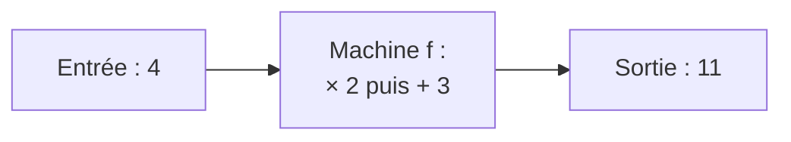

# 📘 Séance 2 – Maths 3ème : On consolide les bases !

> 👋 Aujourd'hui, on prend le temps de bien comprendre **trois chapitres importants**, étape par étape.
> On va doucement : d'abord on comprend, ensuite on s'entraîne. Pose toutes les questions que tu veux 😉

## 🗺️ Au programme

1. 🔥 Échauffement
2. ➖➕ Les signes et les parenthèses
3. 📐 Le théorème de Pythagore
4. 📈 Les fonctions : image et antécédent
5. 🏠 Pour t'entraîner à la maison

---

## 🔥 Échauffement

**Calcule de tête :**

| 3² | 7² | 10² | 12² | (−4)² | 0,5² |
|---|---|---|---|---|---|
| | | | | | |

| √25 | √81 | √144 | √1 | √49 |
|---|---|---|---|---|
| | | | | |

<details>
<summary>✅ Correction</summary>

| 3² | 7² | 10² | 12² | (−4)² | 0,5² |
|---|---|---|---|---|---|
| 9 | 49 | 100 | 144 | 16 | 0,25 |

| √25 | √81 | √144 | √1 | √49 |
|---|---|---|---|---|
| 5 | 9 | 12 | 1 | 7 |

💡 3² = 3 × 3 (et **pas** 3 × 2 !). √25 = 5 car 5² = 25.

</details>

---

## 1. ➖➕ Les signes et les parenthèses

### 📌 Cours

#### ① Additionner et soustraire : pense à l'argent 💶

Un nombre positif = de l'argent que **tu gagnes**. Un nombre négatif = une **dette**.

- −3 + 5 → j'ai une dette de 3 €, je gagne 5 € → il me reste **2 €** → **−3 + 5 = 2**
- −4 − 6 → dette de 4 €, puis dette de 6 € → dette de **10 €** → **−4 − 6 = −10**

#### ② Deux signes côte à côte

| Écriture | Devient | Règle |
|---|---|---|
| + (+3) | + 3 | signes **identiques** → **+** |
| − (−3) | + 3 | signes **identiques** → **+** |
| + (−3) | − 3 | signes **différents** → **−** |
| − (+3) | − 3 | signes **différents** → **−** |

Exemple : 7 − (−2) = 7 + 2 = **9**

#### ③ Enlever des parenthèses

- **Un « + » devant la parenthèse** → on enlève les parenthèses **sans rien changer**.
  7 + (3 − 10) = 7 + 3 − 10 = **0**
- **Un « − » devant la parenthèse** → on enlève les parenthèses et on **change TOUS les signes** à l'intérieur.
  12 − (5 − 8) = 12 **−** 5 **+** 8 = **15**

⚠️ Piège : 8 − (3 − 5) ≠ 8 − 3 − 5. Le −5 devient **+5** ! → 8 − 3 + 5 = 10

#### ④ Multiplier et diviser : la règle des signes

| × ou ÷ | **+** | **−** |
|---|---|---|
| **+** | + | − |
| **−** | − | + |

👉 Signes **identiques** → résultat **positif** · signes **différents** → résultat **négatif**

(−3) × (−4) = 12 · (−3) × 4 = −12 · (−20) ÷ 5 = −4

#### ⑤ L'ordre des calculs (priorités)

1. Ce qui est **entre parenthèses**
2. Les **puissances** (carrés…)
3. Les **× et ÷**
4. Les **+ et −** (de gauche à droite)

⚠️ (−3)² = (−3) × (−3) = **9** mais −3² = −(3 × 3) = **−9**

✍️ **Méthode** : on écrit **une seule étape par ligne** et on souligne le calcul prioritaire.

```
G = −2 × (6 − 10) + 7
G = −2 × (−4) + 7       ← parenthèses d'abord
G = 8 + 7               ← puis la multiplication
G = 15
```

---

### 🟢 Exercice 1.1 – Additions et soustractions

a) 5 + (−3)  b) −4 + (+7)  c) 6 − (+9)  d) −2 − (−8)  e) −5 − (−5)

<details>
<summary>✅ Correction</summary>

a) 5 − 3 = **2**
b) −4 + 7 = **3**
c) 6 − 9 = **−3**
d) −2 + 8 = **6**
e) −5 + 5 = **0**

</details>

### 🟢 Exercice 1.2 – Multiplications et divisions

a) (−3) × 4  b) (−7) × (−2)  c) 5 × (−6)  d) (−8) ÷ (−2)  e) (−1) × (−1) × (−1)

<details>
<summary>✅ Correction</summary>

a) **−12**  b) **14**  c) **−30**  d) **4**
e) (−1) × (−1) = 1, puis 1 × (−1) = **−1** (3 facteurs négatifs → nombre impair → négatif)

</details>

### 🟡 Exercice 1.3 – Enlever les parenthèses

- A = 7 + (3 − 10)
- B = 12 − (5 − 8)
- C = −4 − (−6 + 2)
- D = (−3 + 8) − (2 − 9)

<details>
<summary>✅ Correction</summary>

- A = 7 + 3 − 10 = **0**
- B = 12 − 5 + 8 = **15**
- C = −4 + 6 − 2 = **0**
- D = −3 + 8 − 2 + 9 = **12**

(Autre méthode pour D : on calcule d'abord les parenthèses → 5 − (−7) = 5 + 7 = 12 ✔)

</details>

### 🟡 Exercice 1.4 – Priorités

- E = 5 − 3 × (−4)
- F = (5 − 3) × (−4)
- G = −2 × (6 − 10) + 7
- H = 18 ÷ (−3) − (−2) × 5

<details>
<summary>✅ Correction</summary>

- E = 5 − (−12) = 5 + 12 = **17**
- F = 2 × (−4) = **−8**
  👉 E et F ont les mêmes nombres, mais les parenthèses changent tout !
- G = −2 × (−4) + 7 = 8 + 7 = **15**
- H = −6 − (−10) = −6 + 10 = **4**

</details>

### 🔴 Exercice 1.5 – Pour aller plus loin

a) **Trouve l'erreur** : un élève a écrit 8 − (3 − 5) = 8 − 3 − 5 = 0. Corrige-le.
b) I = −3 × [4 − (2 − 7)]
c) J = (−2)² − 3 × (−1 − 4)
d) K = [10 − (−2) × 3] ÷ (−4)

<details>
<summary>✅ Correction</summary>

a) Il y a un « − » devant la parenthèse : il faut changer **tous** les signes, donc −5 devient +5.
8 − (3 − 5) = 8 − 3 + 5 = **10**

b) On commence par la parenthèse la plus à l'intérieur :
2 − 7 = −5 → 4 − (−5) = 9 → I = −3 × 9 = **−27**

c) (−2)² = 4 et −1 − 4 = −5
J = 4 − 3 × (−5) = 4 + 15 = **19**

d) (−2) × 3 = −6, donc 10 − (−6) = 16
K = 16 ÷ (−4) = **−4**

</details>

---

## 2. 📐 Le théorème de Pythagore

### 📌 Cours

#### ① Le vocabulaire

```
  A
  |\
  | \
  |  \   ← [AC] est l'HYPOTÉNUSE
  |   \
  |____\
  B     C
  ↑
  angle droit en B
```

- L'**hypoténuse** est le côté **en face de l'angle droit**.
- C'est toujours **le plus long côté** du triangle rectangle.
- Les deux autres côtés ([AB] et [BC]) sont les **côtés de l'angle droit**.

#### ② Le théorème (pour calculer une longueur)

> **Si** un triangle est **rectangle**, **alors** :
> **hypoténuse² = côté² + côté²**

Dans le triangle ci-dessus (rectangle en B) : **AC² = AB² + BC²**

#### ③ Calculer l'hypoténuse : la méthode en 4 lignes

Exemple : ABC rectangle en B, AB = 3 cm, BC = 4 cm. Calculer AC.

```
Le triangle ABC est rectangle en B, donc d'après le théorème de Pythagore :
AC² = AB² + BC²
AC² = 3² + 4² = 9 + 16 = 25
AC = √25 = 5 cm
```

#### ④ Calculer un côté de l'angle droit : on SOUSTRAIT

Exemple : ABC rectangle en B, AC = 10 cm (hypoténuse), AB = 6 cm. Calculer BC.

```
AC² = AB² + BC²
10² = 6² + BC²
100 = 36 + BC²
BC² = 100 − 36 = 64
BC = √64 = 8 cm
```

💡 Astuce : **l'hypoténuse est toujours seule de son côté du « = »**.

#### ⑤ La réciproque (pour savoir si un triangle est rectangle)

On calcule **séparément** :
1. le carré du **plus grand côté** ;
2. la **somme des carrés** des deux autres.

- Si c'est **égal** → le triangle **est rectangle** (réciproque de Pythagore).
- Si ce n'est **pas égal** → le triangle **n'est pas rectangle**.

#### 📋 Carrés à connaître par cœur

| n | 1 | 2 | 3 | 4 | 5 | 6 | 7 | 8 | 9 | 10 | 11 | 12 | 13 | 14 | 15 |
|---|---|---|---|---|---|---|---|---|---|---|---|---|---|---|---|
| n² | 1 | 4 | 9 | 16 | 25 | 36 | 49 | 64 | 81 | 100 | 121 | 144 | 169 | 196 | 225 |

---

### 🟢 Exercice 2.1 – Trouver l'hypoténuse

Pour chaque triangle, donne l'hypoténuse puis écris l'égalité de Pythagore.

a) ABC rectangle en B  b) MNP rectangle en P  c) RST rectangle en R

<details>
<summary>✅ Correction</summary>

a) Hypoténuse **[AC]** → AC² = AB² + BC²
b) Hypoténuse **[MN]** → MN² = MP² + NP²
c) Hypoténuse **[ST]** → ST² = RS² + RT²

💡 L'hypoténuse est formée des deux lettres qui **ne sont pas** le sommet de l'angle droit.

</details>

### 🟢 Exercice 2.2 – Calculer l'hypoténuse

a) EFG est rectangle en F, avec EF = 3 cm et FG = 4 cm. Calcule EG.
b) IJK est rectangle en J, avec IJ = 5 cm et JK = 12 cm. Calcule IK.

<details>
<summary>✅ Correction</summary>

a) EFG est rectangle en F, donc d'après le théorème de Pythagore :
EG² = EF² + FG² = 3² + 4² = 9 + 16 = 25
EG = √25 = **5 cm**

b) IJK est rectangle en J, donc d'après le théorème de Pythagore :
IK² = IJ² + JK² = 5² + 12² = 25 + 144 = 169
IK = √169 = **13 cm**

</details>

### 🟡 Exercice 2.3 – Calculer un côté de l'angle droit

a) LMN est rectangle en M, avec LN = 10 cm et LM = 6 cm. Calcule MN.
b) ABC est rectangle en A, avec AB = 4 cm et AC = 7 cm. Calcule BC (arrondi au dixième, avec la calculatrice).

<details>
<summary>✅ Correction</summary>

a) LMN est rectangle en M, donc l'hypoténuse est [LN]. D'après le théorème de Pythagore :
LN² = LM² + MN²
10² = 6² + MN²
100 = 36 + MN²
MN² = 100 − 36 = 64
MN = √64 = **8 cm**

b) ABC est rectangle en A, donc l'hypoténuse est [BC] :
BC² = AB² + AC² = 16 + 49 = 65
BC = √65 ≈ **8,1 cm**

</details>

### 🟡 Exercice 2.4 – Rectangle ou pas ?

a) DEF avec DE = 8 cm, EF = 15 cm et DF = 17 cm.
b) GHI avec GH = 6 cm, HI = 7 cm et GI = 9 cm.

<details>
<summary>✅ Correction</summary>

a) Le plus grand côté est [DF].
- DF² = 17² = 289
- DE² + EF² = 64 + 225 = 289

DF² = DE² + EF², donc d'après la **réciproque** du théorème de Pythagore, DEF est **rectangle en E**.

b) Le plus grand côté est [GI].
- GI² = 9² = 81
- GH² + HI² = 36 + 49 = 85

81 ≠ 85, donc GHI **n'est pas rectangle**.

</details>

### 🔴 Exercice 2.5 – Problèmes

a) 🪜 Une échelle de 5 m est posée contre un mur vertical. Son pied est à 1,4 m du mur. À quelle hauteur l'échelle touche-t-elle le mur ?

b) 📺 Un écran de télévision mesure 80 cm de large et 45 cm de haut. Calcule la longueur de sa diagonale (arrondie au dixième).

c) Un rectangle ABCD a pour longueur AB = 12 cm et pour largeur BC = 5 cm. Calcule la longueur de la diagonale [AC].

<details>
<summary>✅ Correction</summary>

a) Le mur, le sol et l'échelle forment un triangle rectangle. L'échelle (5 m) est l'**hypoténuse**.
5² = 1,4² + h²
25 = 1,96 + h²
h² = 25 − 1,96 = 23,04
h = √23,04 = **4,8 m**

b) La diagonale est l'hypoténuse d'un triangle rectangle :
d² = 80² + 45² = 6 400 + 2 025 = 8 425
d = √8 425 ≈ **91,8 cm**

c) Dans un rectangle, les angles sont droits : ABC est rectangle en B.
AC² = AB² + BC² = 144 + 25 = 169
AC = √169 = **13 cm**

</details>

---

## 3. 📈 Les fonctions : image et antécédent

### 📌 Cours

#### ① Une fonction, c'est une machine 🤖

On met un nombre **en entrée**, la machine fait **toujours le même calcul**, et un nombre **sort**.



On écrit : **f(4) = 11** (on lit « f de 4 égale 11 »).
De façon générale, pour un nombre x quelconque : **f(x) = 2x + 3**.

#### ② Image et antécédent

| | Entrée (ce qu'on met) | Sortie (ce qui sort) |
|---|---|---|
| Nom | **antécédent** | **image** |
| Dans f(4) = 11 | 4 | 11 |

💡 Pour retenir : **ANTÉcédent = AVANT** (ce qui entre) · **IMAGE = APRÈS** (ce qui sort).

Ces trois phrases veulent dire **exactement la même chose** :
- f(4) = 11
- **L'image de 4** par f est 11.
- **4 est un antécédent de 11** par f.

⚠️ Un nombre a **une seule image**, mais il peut avoir **plusieurs antécédents** (ou aucun).

#### ③ Calculer une image : on remplace x

f(x) = 2x + 3. Calculer l'image de −5 :
f(−5) = 2 × **(−5)** + 3 = −10 + 3 = **−7**

⚠️ Avec un nombre négatif, on met **toujours des parenthèses** !

#### ④ Trouver un antécédent : on connaît la sortie, on cherche l'entrée

- Avec une **formule** → on résout une équation. Antécédent de 13 par f(x) = 2x + 3 : 2x + 3 = 13 → 2x = 10 → **x = 5**.
- Avec un **tableau** → on cherche le nombre dans la **2ᵉ ligne** et on lit au-dessus.
- Avec un **graphique** → on part de l'axe **vertical** (voir ⑥).

#### ⑤ Le tableau de valeurs

| x (antécédents) | −1 | 0 | 1 | 2 |
|---|---|---|---|---|
| f(x) (images) | 1 | 3 | 5 | 7 |

1ʳᵉ ligne = ce qui **entre** · 2ᵉ ligne = ce qui **sort**

#### ⑥ Le graphique (la courbe)

Chaque point de la courbe a pour coordonnées **(antécédent ; image)** = **(x ; f(x))**.

- **Axe horizontal** (abscisses) → les **antécédents** x
- **Axe vertical** (ordonnées) → les **images** f(x)

| Je cherche… | Je pars de… | Je lis sur… |
|---|---|---|
| l'**image** de a | a sur l'axe **horizontal** | l'axe **vertical** |
| les **antécédents** de b | b sur l'axe **vertical** | l'axe **horizontal** |

---

### 🟢 Exercice 3.1 – La machine

La machine f : « multiplier par 3, puis soustraire 1 ».

a) Que sort-il si on entre 2 ? 0 ? −4 ?
b) Écris f(x) pour un nombre x quelconque.

<details>
<summary>✅ Correction</summary>

a)
- 2 × 3 − 1 = 6 − 1 = **5** → f(2) = 5
- 0 × 3 − 1 = **−1** → f(0) = −1
- (−4) × 3 − 1 = −12 − 1 = **−13** → f(−4) = −13

b) **f(x) = 3x − 1**

</details>

### 🟢 Exercice 3.2 – Les bonnes phrases

a) On sait que f(5) = 8. Complète : « L'image de 5 par f est … » et « 5 est un … de … par f ».
b) On sait que g(−2) = 6. Complète : « … est l'image de … par g » et « … est un antécédent de … par g ».
c) Traduis avec une égalité : « L'image de 3 par h est 10 » et « 7 est un antécédent de 0 par k ».

<details>
<summary>✅ Correction</summary>

a) « L'image de 5 par f est **8** » · « 5 est un **antécédent** de **8** par f »
b) « **6** est l'image de **−2** par g » · « **−2** est un antécédent de **6** par g »
c) **h(3) = 10** · **k(7) = 0**

</details>

### 🟡 Exercice 3.3 – Lire un tableau

| x | −2 | −1 | 0 | 1 | 2 | 3 |
|---|---|---|---|---|---|---|
| f(x) | 4 | 1 | 0 | 1 | 4 | 9 |

a) Quelle est l'image de −1 ? Que vaut f(3) ?
b) Quels sont les antécédents de 4 ? de 1 ? de 0 ?
c) Quel est l'antécédent de 9 visible dans le tableau ?

<details>
<summary>✅ Correction</summary>

a) L'image de −1 est **1**. f(3) = **9**.
b)
- Antécédents de 4 : **−2 et 2**
- Antécédents de 1 : **−1 et 1**
- Antécédent de 0 : **0**

c) **3** (on cherche 9 dans la 2ᵉ ligne et on lit au-dessus).

👉 On voit bien qu'un nombre peut avoir **plusieurs antécédents**.

</details>

### 🟡 Exercice 3.4 – Avec une formule

Soit f(x) = −2x + 5.

a) Calcule f(0), f(3) et f(−4).
b) Trouve l'antécédent de 1 par f.

<details>
<summary>✅ Correction</summary>

a)
- f(0) = −2 × 0 + 5 = **5**
- f(3) = −2 × 3 + 5 = −6 + 5 = **−1**
- f(−4) = −2 × (−4) + 5 = 8 + 5 = **13**

b) On cherche x tel que −2x + 5 = 1
−2x = 1 − 5 = −4
x = (−4) ÷ (−2) = **2**
Vérification : f(2) = −4 + 5 = 1 ✔

</details>

### 🔴 Exercice 3.5 – Attention aux signes !

Soit g(x) = x² − 2x.

a) Calcule g(3), g(−1), g(0), g(2) et g(−2).
b) Quels antécédents de 3 as-tu trouvés ? Et de 0 ?

<details>
<summary>✅ Correction</summary>

a)
- g(3) = 3² − 2 × 3 = 9 − 6 = **3**
- g(−1) = (−1)² − 2 × (−1) = 1 + 2 = **3**
- g(0) = 0 − 0 = **0**
- g(2) = 4 − 4 = **0**
- g(−2) = (−2)² − 2 × (−2) = 4 + 4 = **8**

b) 3 a pour antécédents **3 et −1**. 0 a pour antécédents **0 et 2**.

</details>

### 🔴 Exercice 3.6 – Lecture graphique

Voici la courbe d'une fonction h.

```mermaid
xychart-beta
    title "Courbe représentative de h"
    x-axis "x" ["-2", "-1", "0", "1", "2", "3", "4"]
    y-axis "h(x)" -6 --> 5
    line [-5, 0, 3, 4, 3, 0, -5]
```

<details>
<summary>📋 Tableau des points de la courbe</summary>

| x | −2 | −1 | 0 | 1 | 2 | 3 | 4 |
|---|---|---|---|---|---|---|---|
| h(x) | −5 | 0 | 3 | 4 | 3 | 0 | −5 |

</details>

a) Quelle est l'image de 0 ? Que vaut h(1) ?
b) Quels sont les antécédents de 3 ? de 0 ?
c) Combien 4 a-t-il d'antécédents ? Et 5 ?

<details>
<summary>✅ Correction</summary>

a) L'image de 0 est **3**. h(1) = **4**.
b) Antécédents de 3 : **0 et 2**. Antécédents de 0 : **−1 et 3**.
c) 4 a **un seul** antécédent : **1** (le sommet de la courbe).
5 n'a **aucun** antécédent (la courbe ne monte jamais jusqu'à 5).

</details>

---

## 🏠 Pour t'entraîner à la maison

**Exercice 1** – Calcule :
- A = −6 − (4 − 9)
- B = 3 × (−2) − (−5) × (−1)
- C = (−4)² − 2 × (3 − 8)

**Exercice 2** – Pythagore :
a) XYZ est rectangle en Y avec XY = 9 cm et YZ = 12 cm. Calcule XZ.
b) Un triangle a pour côtés 5 cm, 6 cm et 8 cm. Est-il rectangle ?

**Exercice 3** – Fonctions : soit f(x) = 4x − 3.
a) Calcule l'image de 2 et l'image de −1.
b) Trouve l'antécédent de 9.

🎉 **Bravo pour cette séance !**


----------------------
a) LMN est rectangle en M, donc l'hypoténuse est [LN]. D'après le théorème de Pythagore :
LN² = LM² + MN²
10² = 6² + MN²
100 = 36 + MN²
100 - 36 = MN²

MN² = 100 − 36 = 64
MN = √64 = **8 cm**
